<p align="center">
  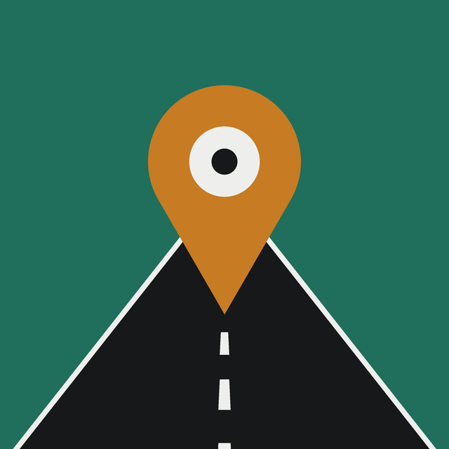
</p>

<h1 align="center">Smart Report IA</h1>

<p align="center">
  Reportes ciudadanos de problemas en la vía pública de El Salvador.<br>
  Una foto por Telegram, agrupada con las de quienes vieron lo mismo, y un aviso de vuelta cuando se arregla.
</p>

<p align="center">
  <a href="https://t.me/smartreport_sv_bot"><b>Probar el bot</b></a> ·
  <a href="https://smart-report-sv.duckdns.org"><b>Abrir el tablero</b></a> ·
  <a href="#cómo-funciona-por-dentro">Cómo funciona</a> ·
  <a href="DESPLIEGUE.md">Desplegar</a>
</p>

<p align="center">
  <a href="https://github.com/GerardoAmaya/smart-report-ia/actions/workflows/ci.yml"></a>
  <a href="https://smart-report-sv.duckdns.org/health"></a>
  
  
</p>

<p align="center">
  
  
  
  
  
  
  
  
  
  <br>
  
  
  
  
  
  
  
</p>

---

Alguien ve un hueco en la calle, le manda una foto a un bot de Telegram, y la
cuadrilla lo ve **agrupado con los otros tres que reportaron lo mismo**.

Hay dos personas con necesidades opuestas. **Quien reporta** está parado frente
al problema, con prisa, y tiene que poder reportar en menos de un minuto sin
instalar nada. **Quien despacha** mira el sistema ocho horas, y su problema no
es recibir reportes sino saber cuáles son el mismo. El sistema existe para la
segunda; la primera es el sensor.

## Pruébalo

Está en producción. Las dos mitades se pueden tocar:

| | |
|---|---|
| 📱 **El bot** | [**@smartreport_sv_bot**](https://t.me/smartreport_sv_bot): *Iniciar*, una foto, tu ubicación |
| 🗺️ **El tablero** | [**smart-report-sv.duckdns.org**](https://smart-report-sv.duckdns.org) |
| 🔑 **Usuario de prueba** | En *Usuario de prueba*, contraseña **`demo-Are2G6f1pOvg`** |
| 🩺 **Estado** | [`/health`](https://smart-report-sv.duckdns.org/health): base, esquema, modelo y almacenamiento |

El usuario de prueba **solo mira**: cola, casos, mapa, métricas y la evidencia
de cada agrupación, y puede hacerle **10 preguntas al día** al asistente.
Despachar está reservado a operadores, porque los casos son reales y cerrar uno
le avisa a quien lo reportó que ya se arregló.

> Lo que mandes al bot aparece en el tablero. Si mandas una foto que no es de la
> vía pública, el modelo la va a proponer como *no es un reporte*, que es lo
> correcto. Y si tu red de trabajo filtra los dominios de DNS dinámico, abre el
> tablero desde el celular.

## Qué hace

```
 foto + ubicación        el modelo propone          el código decide
 por Telegram      →     categoría y urgencia   →   si es el mismo caso   →  cuadrilla
      ↑                  (la persona confirma)      (distancia y foto)         │
      └──────────────  aviso de vuelta a todos los que reportaron  ───────────┘
```

El principio que sostiene todo: **el modelo propone, el código decide, y lo que
no se puede sostener se informa.** El modelo clasifica y sugiere; no asigna
cuadrillas ni cierra casos. La agrupación la decide código con umbrales
medidos, muestra su evidencia y se puede deshacer. Lo que queda en el límite se
marca como dudoso, con el motivo, esperando a una persona.

El riesgo que esto evita: **agrupar mal en silencio.** Si el sistema junta dos
huecos distintos en un caso, la cuadrilla arregla uno y cierra los dos, y el
problema real queda escondido detrás de un ticket resuelto.

## Cómo se ve

### Para quien reporta

Un hueco anegado en Mejicanos. Foto, ubicación por el botón nativo de Telegram,
y listo: menos de un minuto, sin instalar nada.

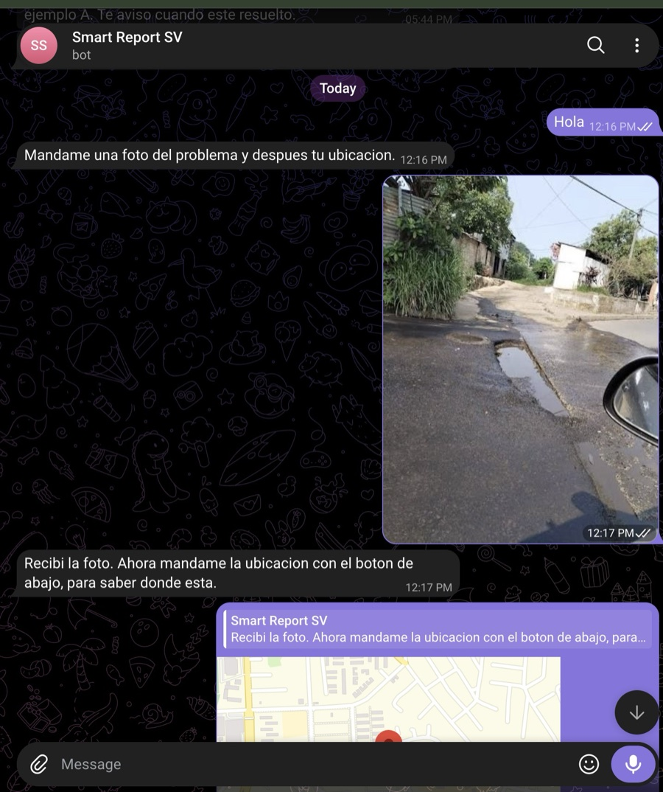

Y lo que casi nadie construye: **el aviso de vuelta**, a todos los que
reportaron y no solo al primero. Cada mensaje dice cuál de sus reportes es
—cuándo lo mandó y dónde— porque la categoría sola no lo distingue.

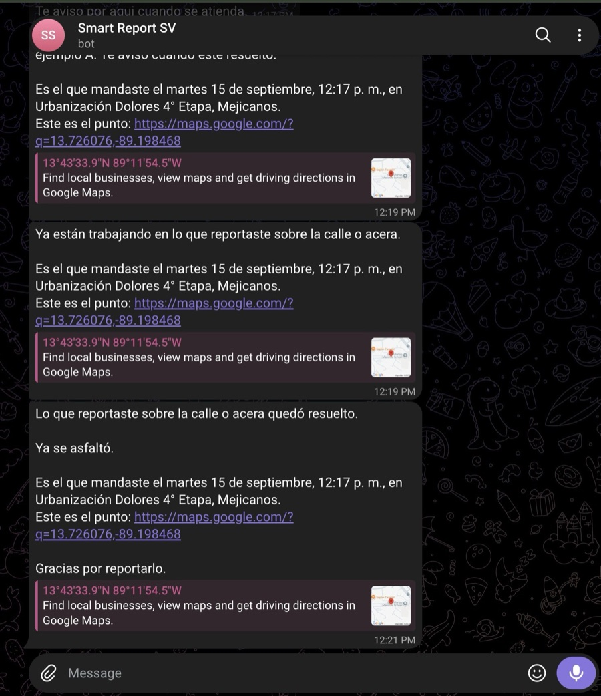

### Para quien despacha

La entrada: Google para quien trabaja aquí, contraseña para quien viene a mirar.

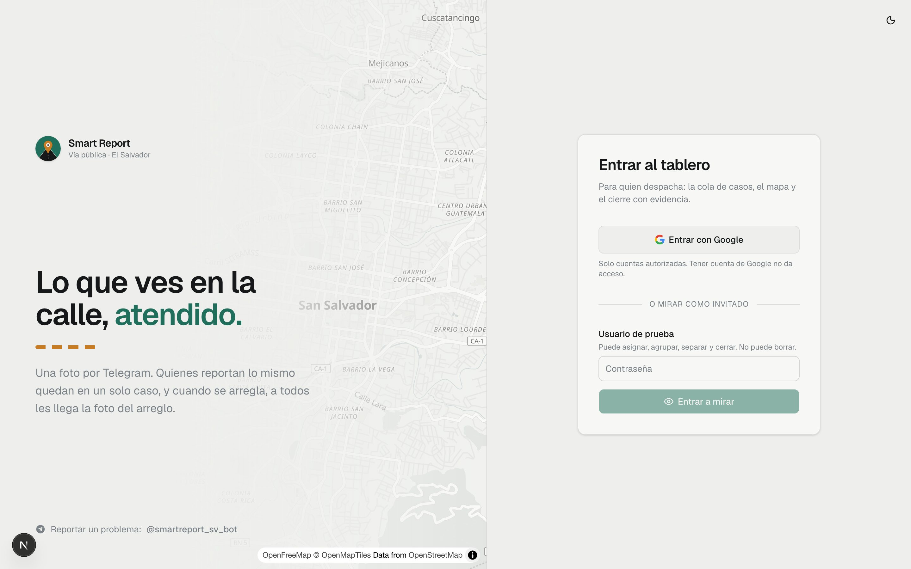

El tablero en vivo: la cola de casos, las métricas y la entrada de reportes en
el tiempo. Se actualiza solo, sin recargar.

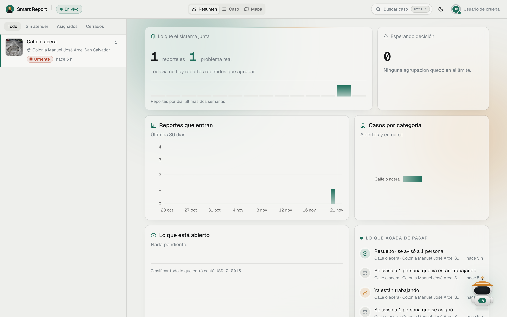

Un caso cerrado, de punta a punta: la foto de quien reportó, la dirección
resuelta, la cuadrilla, cuándo se asignó y se resolvió, **la foto del arreglo**
y a cuántas personas se les avisó. No se cierra sin esa foto: un cierre sin
evidencia es una afirmación que nadie puede comprobar.

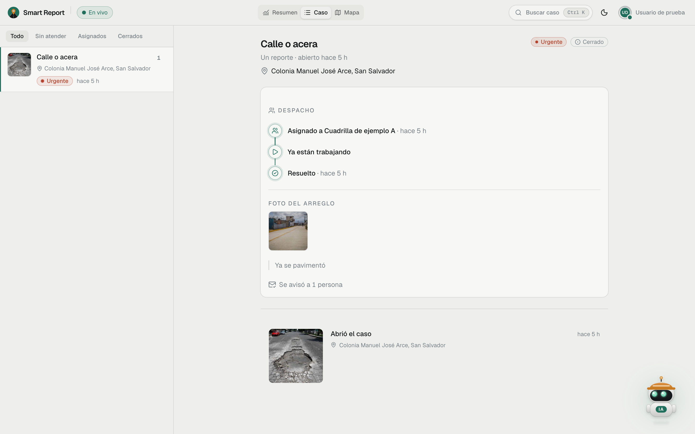

El mapa, con la paleta del proyecto: agua, parques y edificios con color, pero
sin rojo ni ámbar, que quedan para lo urgente. El tamaño del pin dice cuántas
personas reportan lo mismo, y lo urgente late.

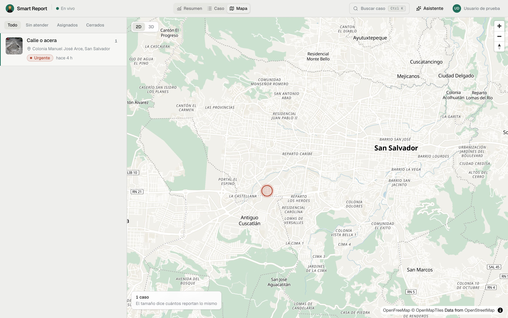

Y en **3D**: los edificios en relieve y los casos como columnas por zona, más
altas donde más gente reporta y rojas donde hay algo urgente. Encuadra solo la
zona con más reportes, las columnas crecen al entrar, y si nadie lo toca la
cámara gira despacio. Sin librerías de 3D: es el mismo MapLibre.

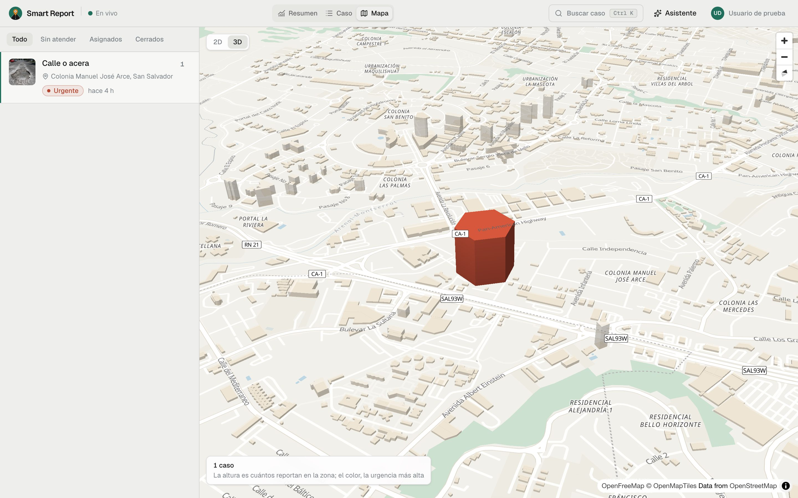

**Pregúntale al tablero.** Lo abre un robot que flota en la esquina: sigue el
cursor con los ojos, parpadea, se pone contento cuando lo señalas, se duerme si
nadie lo usa y se puede arrastrar a donde estorbe menos. De vez en cuando avisa
—«Hay 2 casos urgentes abiertos»— con el número real.

<p align="center">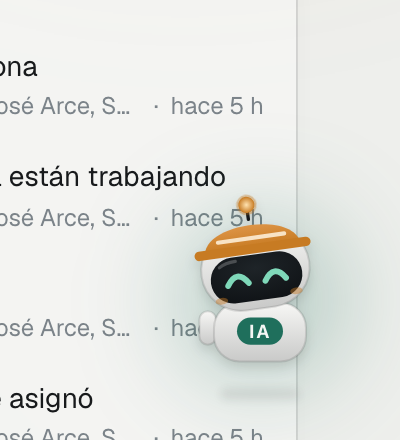</p>

En el panel se escribe «¿qué quedó pendiente?» o «resumen de la semana», y el
modelo contesta con los datos del sistema y enlaces a cada caso. **Solo puede
mirar**: sus herramientas son consultas escritas en código, corren en una
transacción de solo lectura, y asignar o cerrar sigue siendo cosa del panel de
cada caso.

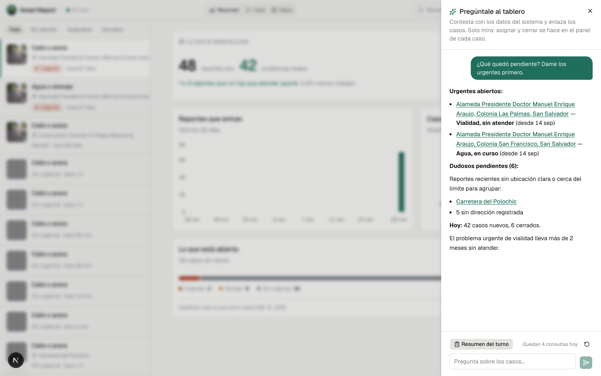

Y donde el sistema duda, una segunda mirada: en un reporte que quedó en el
límite de la agrupación, **«Comparar las fotos»** le pide al modelo que mire las
dos y diga en qué se parecen y en qué no. Da una sugerencia; decide la persona.

Además: buscador con **Ctrl+K**, miniatura de cada foto en la cola, un aviso en
pantalla cada vez que se despacha algo, y **«Lo que acaba de pasar»**: el
resumen trae un feed con lo que ocurre de verdad —reportes que entran, casos que
se juntan, asignaciones, cierres y a cuántas personas se avisó—, que se mueve
solo por los mismos avisos de Postgres que el resto del tablero.

**Usuarios y perfil.** Quién entra lo decide una lista de correos autorizados
con su rol, y ahora se gestiona desde el tablero: un administrador autoriza un
correo, cambia roles o quita el acceso, sin tocar el servidor. Nadie se puede
quitar a sí mismo el rol de administrador, y nunca se queda el sistema sin
uno. Cada persona tiene su foto —la de Google, o una propia— y su nombre.

En el celular el tablero cambia de forma: una barra abajo con Cola, Resumen,
Caso y Mapa, y cada vista a pantalla completa. Quien despacha desde la calle
puede asignar, marcar en curso y subir la foto del arreglo desde el teléfono.

<p align="center">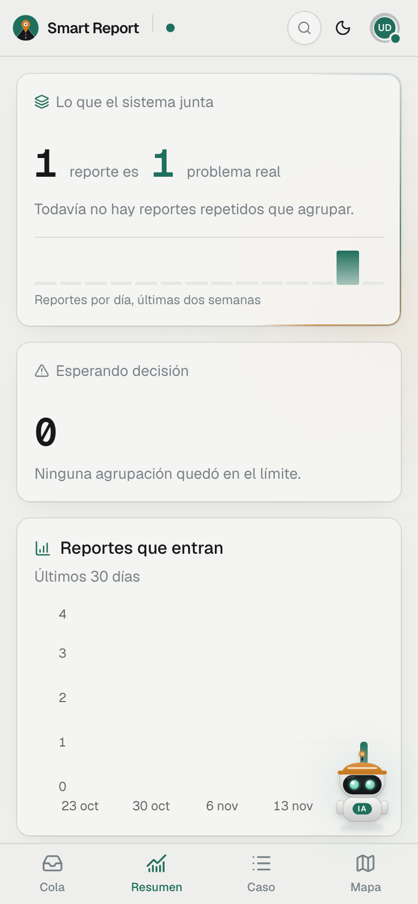</p>

> Las capturas del tablero las saca un guion contra lo que haya en la base, no
> una mano: `cd frontend && DEMO_PASSWORD=… node scripts/capturas.mjs`.

## Cómo funciona por dentro

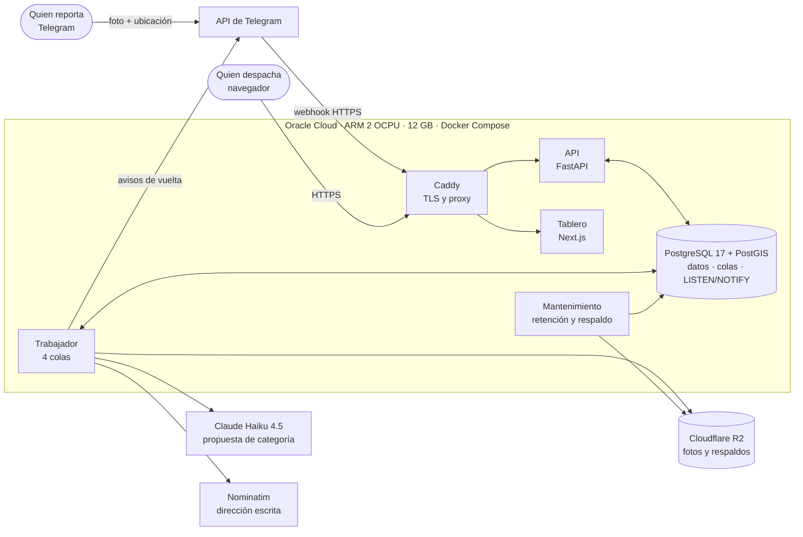

Seis decisiones que definen la forma del sistema:

- **El webhook no hace ni una llamada de red saliente.** La respuesta a quien
  reporta viaja en el cuerpo de la propia respuesta HTTP. La foto, el modelo y
  la dirección van a colas, fuera del camino que Telegram cronometra.
- **La cola vive en Postgres**, con `SELECT … FOR UPDATE SKIP LOCKED`, y el
  tablero se entera de los cambios por `LISTEN/NOTIFY` y SSE. Sin Redis y sin
  bus de mensajes: un segundo almacén es infraestructura que hay que desplegar,
  vigilar y explicar.
- **Se agrupa por la categoría que confirmó una persona**, nunca por la que
  propuso el modelo, y por distancia medida con PostGIS. La huella perceptual
  de la foto se anota como evidencia pero **no fuerza** una unión: una imagen
  idéntica a 60 m puede ser un reenvío.
- **Tres salidas y no dos:** agrupado, dudoso o solo. La banda de duda existe
  porque la asimetría manda: separar dos reportes del mismo caso es molesto;
  juntar dos problemas distintos esconde uno.
- **Si el modelo falla, el sistema sigue.** Sin saldo o sin servicio, el bot le
  pide la categoría a la persona con botones, y el reporte entra igual.
- **El cierre lleva su prueba.** No se cierra sin foto del arreglo, solo se
  puede con el caso en curso, y el aviso de «resuelto» le llega a quien reportó
  **con esa foto**: quien vio el problema es quien mejor sabe si se arregló.

El razonamiento completo, y lo que cada decisión costó descubrir, está en
[`docs/DISENO.md`](docs/DISENO.md).

## Con qué está hecho

| Capa | Tecnología | Por qué esta |
|---|---|---|
| **API** | FastAPI · SQLAlchemy 2 · Alembic · Python 3.13 | tipos de punta a punta y migraciones versionadas |
| **Base** | PostgreSQL 17 + PostGIS 3.5 | distancia geográfica real, y además cola y bus de eventos |
| **Modelo** | Claude Haiku 4.5, con salida por esquema | no puede inventar una categoría: o cae en el enum o la llamada falla |
| **Asistente** | Claude Haiku 4.5 con *tool use* de solo lectura | las consultas las escribe el código, no el modelo; el modelo solo elige cuál |
| **Canal** | Telegram Bot API, detrás de una interfaz `InboundChannel` | sin instalar nada; WhatsApp sería otro adaptador, no un rediseño |
| **Fotos** | Cloudflare R2 (S3), MinIO en local | el tablero sirve las mismas fotos ocho horas al día, y R2 no cobra salida |
| **Tablero** | Next.js 16 · React 19 · TypeScript 6 · Tailwind 4 · shadcn/ui · cmdk · Sonner | |
| **Movimiento** | Motion · componentes de Magic UI copiados al proyecto | animaciones con propósito; todo se queda quieto con «reducir movimiento» |
| **Mapa** | MapLibre 6 con teselas de OpenFreeMap | gratis, sin clave y sin límite de cargas |
| **Datos en vivo** | TanStack Query + SSE | el tablero escucha y no habla: no hace falta WebSocket |
| **Servidor** | Docker Compose · Caddy 2 · Oracle Cloud Always Free (ARM) | un solo origen con HTTPS automático, sin CORS |
| **Pruebas** | pytest · Playwright · GitHub Actions | las E2E corren contra el sistema levantado, con un Telegram falso |

## Estado

| Fase | | |
|---|---|---|
| 0 · Esqueleto | ✅ cerrada | |
| 1 · El canal | ✅ cerrada | webhook, límites, cero llamadas salientes |
| 2 · Almacenamiento | ✅ cerrada | miniaturas, huella perceptual, retención |
| 3 · Clasificación | 🟡 abierta | falta la muestra de 200 fotos etiquetadas |
| 4 · Agrupación | 🟡 abierta | faltan 200 reportes agrupados a mano |
| 5 · El tablero | 🟡 abierta | falta que alguien que no lo vio lo entienda solo |
| 6 · Despacho y cierre | ✅ cerrada | ciclo real completo, de la foto al aviso de cerrado |
| 7 · Tiempo real y E2E | ✅ cerrada | SSE sobre `LISTEN/NOTIFY`, 11 recorridos en CI |
| 8 · Despliegue | ✅ cerrada | un reporte real de punta a punta en producción, con su costo medido |

Las fases abiertas lo están porque **sus verificaciones piden datos que todavía
no existen**, no porque falte código: el que las mide está escrito y avisa
cuando la muestra no alcanza en vez de dar un número. Una fase sin verificación
es una fase que alguien cree que terminó.

## Lo que cuesta

Todo corre en una máquina, y todo lo que la rodea está en un nivel gratuito
**permanente**, no en una prueba que vence al mes:

| Pieza | Servicio | Costo |
|---|---|---|
| Servidor (2 núcleos ARM, 12 GB) | Oracle Cloud Always Free | USD 0 |
| Fotos y respaldos (10 GB, sin costo de salida) | Cloudflare R2 | USD 0 |
| Dominio | DuckDNS | USD 0 |
| HTTPS | Let's Encrypt, renovado por Caddy | USD 0 |
| Mapa y direcciones | OpenFreeMap y Nominatim | USD 0 |
| Integración continua | GitHub Actions | USD 0 |
| **Clasificar una foto** | Claude Haiku 4.5, con miniatura | **USD 0,0018** |
| Una pregunta al asistente | Claude Haiku 4.5, con herramientas | USD 0,006 |
| Comparar dos fotos dudosas | Claude Haiku 4.5 | USD 0,003 |

El modelo es el único costo real, y por uso: mil fotos son menos de dos
dólares. El asistente tiene tope diario por persona —10 consultas el invitado,
40 cada operador—, así que el acceso público no puede gastar más de unos
USD 0,07 al día. La foto es dos tercios de cada llamada, así que se le manda la
miniatura y no el original. Cómo se levanta todo, paso a paso y con lo que
hace perder una tarde si no se sabe, está en [`DESPLIEGUE.md`](DESPLIEGUE.md).

## Métricas

Se llenan con el número medido, nunca con una promesa.

| Qué | Valor | Fase |
|---|---|---|
| Exactitud de clasificación | pendiente de etiquetas | 3 |
| Costo de clasificación por foto | **USD 0,0018** | 3 |
| Agrupaciones incorrectas (falsos positivos) | — | 4 |
| Agrupaciones perdidas (falsos negativos) | — | 4 |
| Costo de almacenamiento por foto | **USD 0,0000201** (n=1) | 2 |
| Costo por reporte | **USD 0,0015** (n=1, el 98 % es el modelo) | 8 |

## Arrancar en local

```bash
cp .env.example .env      # poner ANTHROPIC_API_KEY y el token de un bot de desarrollo
make up
make seed
```

| | |
|---|---|
| Tablero | http://localhost:3100 |
| API | http://localhost:8000/health · [docs](http://localhost:8000/docs) |
| MinIO | http://localhost:9001 |
| Postgres | `localhost:5433` |

Usa un bot **distinto** del de producción: un bot admite un solo webhook, y
`make tunnel` lo apunta a tu máquina.

| Comando | |
|---|---|
| `make test` | pytest contra la base levantada |
| `make lint` | ruff, ESLint y `tsc --noEmit` |
| `make e2e` | los once recorridos contra el sistema levantado |
| `make tunnel` | túnel HTTPS y registro del webhook en Telegram |
| `make bench` · `make accuracy` · `make grouping-eval` | los que **miden**: costo, exactitud y las dos tasas de agrupación |

`make help` lista el resto.

## Documentación

| | |
|---|---|
| [`PLAN.md`](PLAN.md) | alcance, fases y la verificación de cada una |
| [`docs/DISENO.md`](docs/DISENO.md) | cómo funciona por dentro y por qué |
| [`DESPLIEGUE.md`](DESPLIEGUE.md) | ponerlo en internet gratis, y operarlo |
| [`CLAUDE.md`](CLAUDE.md) | las decisiones tomadas, con su motivo |

Identificadores, cadenas y commits en inglés; comentarios y documentación en
español. Commits en formato Conventional Commits.
